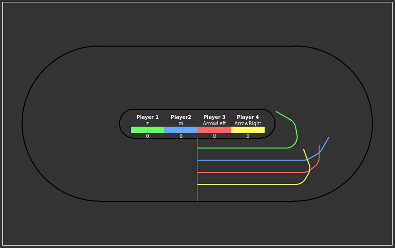

# 🏁 Racer Game

## 🏍️ [Play now](https://volter2pl.github.io/racer/)

---

## 🎮 Quick Start

🧑‍🤝‍🧑 Join up to **4 players**  
🎨 Assign unique **colors** and **keys**  
↩️ Turn **left only**  
💨 Speed increases per lap  
🏆 **Winner** = most laps completed  
💻 Local play, one keyboard

---

## 📘 Gameplay Manual

### 📝 Player Setup

- Press **C** to enter player names (up to 4).
- Each player will be assigned:
    - a **unique control key**,
    - a **distinct color**.
- You can **change key/color** by clicking them on screen.

### 🎯 Game Controls

- **SPACE** – start the race.
- Each player uses **only one key** to turn **left**.
- The longer you hold the key, the **sharper the turn**.

### 🧠 Game Mechanics

- Each player's trail is shown on the track using their color.
- Trails **reset after each lap**, giving a fresh start.
- If you hit the inner or outer wall — you're out.
- Speed **increases after each lap**, so precision is key.

### 🏆 Scoring

- The game ends when all players crash.
- The winner is the player who **completed the most laps**.

---

**🔥 Good luck and have fun!**
